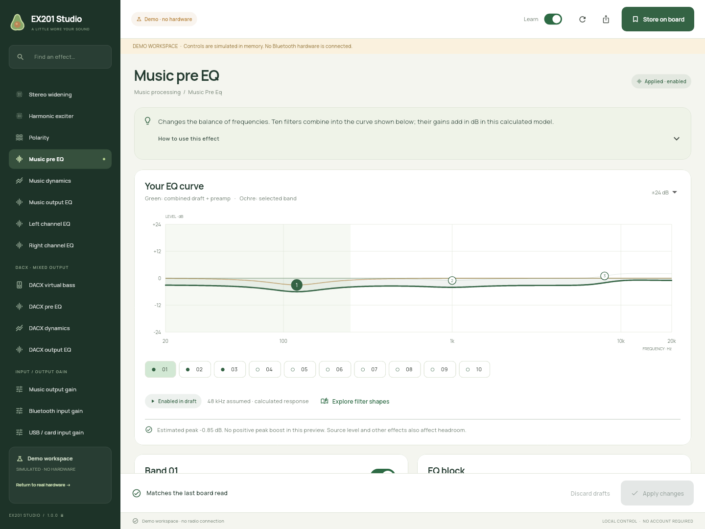
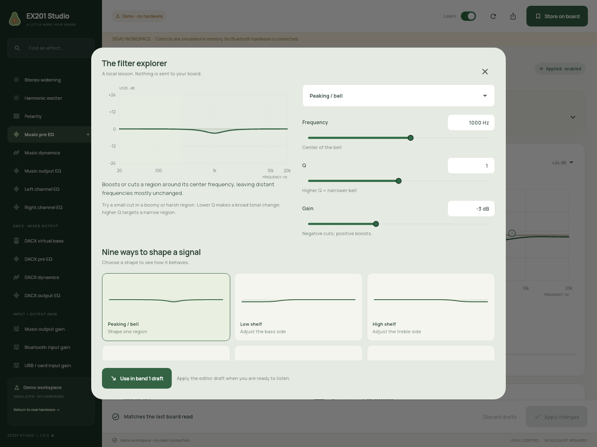

# EX201 Studio

A native Linux workspace for the EX201 Bluetooth audio DSP: precise controls,
interactive EQ curves, visual lessons, and recoverable tuning sessions.

Built entirely with Flutter and Dart. Bluetooth uses Linux BlueZ directly;
the application runs without Python, a browser, a web server, or a vendor account.



## Install

Download `EX201-Studio-1.0.0-x86_64.flatpak` from
[Releases](https://github.com/big-yellow-duck/ex201-studio/releases), then open it
with your software manager, or run:

```sh
flatpak install --user EX201-Studio-1.0.0-x86_64.flatpak
flatpak run io.github.big_yellow_duck.EX201Studio
```

The x86_64 bundle uses the Freedesktop 26.08 runtime from Flathub. It requests
the display, graphics acceleration and access to the host BlueZ service.
It has no network or general home-directory access. Import/export uses the
desktop file chooser; backups stay in the application’s data directory.

## A tuning session

1. Connect the board’s **BLE control device**, then read its settings.
2. Export a preset before changing your tuning.
3. Edit a filter or explore a lesson. All effect edits remain local drafts.
4. **Apply changes** sends a draft and verifies the complete returned block.
5. **Store on board** retains the applied DSP tuning across power-off.

The separate Bluetooth audio link is managed through Linux’s normal audio
settings. Use one controller application at a time.

You can explore every editor without hardware:

```sh
flatpak run io.github.big_yellow_duck.EX201Studio --demo
```

Close an existing instance before launching the demo action. The amber demo
banner marks a separate in-memory transport; it never connects to Bluetooth.
Demo backups are kept separately from real-board backups.

## Features

- All **19 discovered DSP blocks and 401 typed controls**, including six ten-band EQs.
- Draggable EQ handles, exact numeric values, selected-band and combined curves,
  preamp and an estimated peak-boost/headroom note.
- Nine filter shapes with explanations and a local interactive explorer.
- Full-band and multiband dynamics with transfer/timing illustrations and active-path guidance.
- Gain/mute, noise suppression, virtual bass, 3D spatial, widening, exciter and polarity.
- Master volume/mute, three board preset slots and last-read DSP diagnostics.
- Compatible v2 preset files, older EQ-only snapshots, automatic backups and recovery.
- A searchable beginner guide, staged edits and a compact learning-off view.



## Supported hardware and limits

Hardware verification used an **EX201 / seller EX201MAX**, BP10_B1, firmware
0.3.1, library 2.30.0. The EX202 and other firmware profiles have not been
hardware-tested. Remote input selection and renaming are unavailable when
the firmware returns no status. TWS, firmware updates and factory reset are
outside this application’s scope.

The charts are teaching models: EQ assumes 48 kHz; dynamics uses ideal
transfer/timing examples; proprietary effect pictures are conceptual.
They are not measurements of the board, amplifier, enclosure or speaker,
and do not constitute a speaker-protection or crossover design.

## Build and check

Pinned toolchain: **Flutter 3.47.8 / Dart 3.13.7**. Install Flutter’s Linux
desktop prerequisites, then:

```sh
flutter pub get
flutter test
flutter analyze
flutter build linux --release
```

`tools/in-sdk.sh` runs Flutter in the Freedesktop 26.08 SDK with LLVM 22,
which is useful on immutable distributions such as Bazzite. Set
`EX201_FLUTTER_SDK` when Flutter is not on your PATH.

For the installable Flatpak:

```sh
flutter precache --linux
tools/build-flatpak.sh
```

The preparation step snapshots the pinned SDK and package cache, verifies the
Flutter commit, and records checksums. The actual Flatpak build resolves
dependencies offline and compiles in its SDK sandbox. Build inputs under
`.flatpak-deps/` are not bundled with the installed application.

## Validation

The tests compare **1,436 parameter plans** with the original Python reference,
including encoding and grouped-write order. Controller tests exercise preset
compatibility, invalid input, full-block readback, failure recovery, volume,
mute and all preset selectors through an explicit simulator. UI checks cover
all editors, local learning drafts, and narrow windows.

Physical EX201 checks verified temporary cuts in already-bypassed EQ, DRC and
gain blocks, restored the original values, and matched all 19 blocks against
the handoff snapshot. The installed Flatpak also read all 401 controls through
its sandboxed BlueZ connection. No flash save or preset switch was used in
these physical migration checks. A sanitized report is in
[docs/validation.json](docs/validation.json).

The original Python/web implementation is preserved alongside this project
in the original workspace; it is not needed to build or run this edition.
The protocol definitions and reference vectors were carried forward from that
implementation and manufacturer-client research.

See [README.txt](README.txt) for the full operating, storage and build reference.
Application source is MIT licensed. Manrope is distributed under the
[SIL Open Font License](assets/fonts/OFL.txt); Flutter bundles dependency notices.
